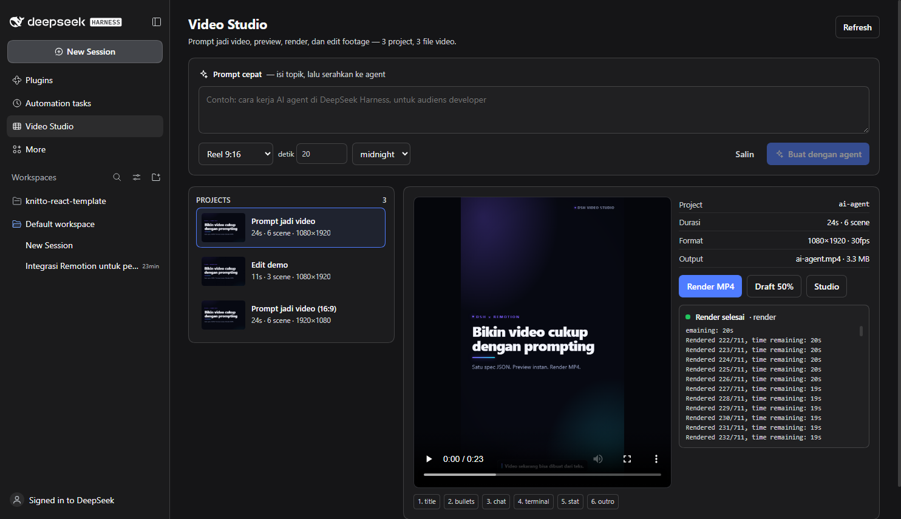
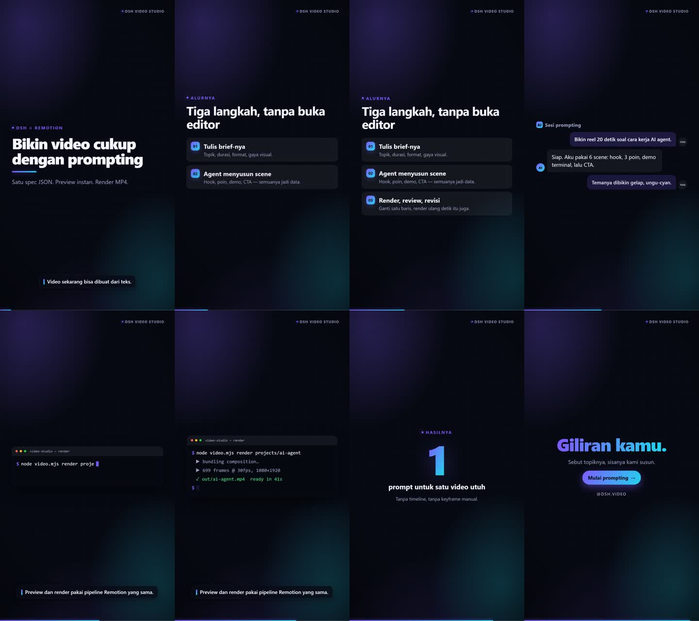

# DSH Video Studio

**Prompt → video** di dalam [DeepSeek Harness](https://github.com/deepseek-ai/deepseek-harness):
satu spec JSON, preview di GUI, render MP4 dengan [Remotion](https://www.remotion.dev).
Bisa juga dipakai untuk memotong dan menyusun ulang footage yang sudah ada.

Repo ini berisi dua bagian:

| Bagian | Isi |
|---|---|
| `plugins/dsh-video-studio/` | Plugin DSH: panel sidebar, preview, tombol render, handoff prompt ke agent |
| `video-studio/` | Engine Remotion + CLI + 13 tipe scene + schema JSON |
| `.dsh/skills/video-studio/` | Skill agent supaya prompting video otomatis memakai alur yang benar |



## Fitur

- **13 tipe scene**: `title`, `bullets`, `stat`, `quote`, `image`, `video`,
  `code`, `terminal`, `chat`, `split`, `bars`, `outro`, `blank`.
- **Satu spec untuk semua format**: 1080×1920, 1920×1080, 1080×1080.
- **5 tema**: midnight, sunset, neon, paper, mono.
- **Video & audio**: trim, playback rate, musik global dengan fade.
- **Edit footage**: `import` memecah video jadi segmen; atur trim, urutan,
  caption, lalu render.
- **Panel GUI**: daftar project, preview MP4 (seek), render penuh/draft,
  Remotion Studio, dan prompt yang membuka sesi agent baru.
- **Skill agent**: cukup minta "buatkan reel 20 detik soal ...".

## Instalasi

Kebutuhan: DSH Desktop, Node.js 22+, Git. Render pertama mengunduh Chrome
Headless Shell (~131 MB); `ffmpeg`/`ffprobe` hanya diperlukan untuk `import`
dan `probe`.

```powershell
git clone https://github.com/dimasknitto/dsh-video-studio.git
cd dsh-video-studio
.\setup.ps1
```

`setup.ps1` menjalankan `npm ci` di `video-studio/`, mendaftarkan plugin ke
profile DSH (`desktop` secara default), dan mencetak langkah berikutnya.

Manual:

```powershell
cd video-studio
npm ci
dsh plugin --profile desktop add "link:<repo>\plugins\dsh-video-studio"
```

Setelah terpasang: buka sidebar → **Video Studio** (refresh/restart DSH bila
panel belum muncul).

> **Jangan copy `node_modules` antar komputer.** Remotion mengunduh binary
> compositor sesuai OS. Selalu jalankan `npm ci` di mesin tujuan.

## Cara pakai

**Dari chat:**

> buatkan reel 20 detik soal cara kerja AI agent, tema gelap ungu-cyan

Agent menulis `video-studio/projects/<slug>/video.json`, memvalidasi, mengecek
still, merender MP4, lalu menyerahkan hasilnya.

**Dari panel:** pilih project → **Render MP4** / **Draft 50%**. Tombol
**Buat dengan agent** membuka sesi baru dengan prompt yang sudah terisi.

**Dari terminal:**

```powershell
cd video-studio
node bin/video.mjs new projects/coba --template reel --title "Coba"
node bin/video.mjs validate projects/coba
node bin/video.mjs thumbs projects/coba --count 6
node bin/video.mjs render projects/coba
```

Render dari terminal membutuhkan akses penuh (spawn Chrome headless); detail
ada di [`video-studio/README.md`](video-studio/README.md).

## Struktur

```
.
├─ plugins/dsh-video-studio/   # plugin: host routes + client panel
├─ video-studio/               # engine: src, bin, schema, projects
│  └─ projects/<slug>/         # video.json + assets/ + out/
├─ .dsh/skills/video-studio/   # skill agent + referensi spec
├─ docs/                       # gambar untuk README
└─ setup.ps1                   # installer satu perintah
```

## Demo

Spec contoh ada di `video-studio/projects/`:

| Project | Isi |
|---|---|
| `ai-agent` | Reel 1080×1920, 23,7 s, 6 scene — hasil render ikut di `out/ai-agent.mp4` |
| `ai-agent-landscape` | Spec sama, dirender 1920×1080 |



Project milikmu sendiri taruh di `video-studio/projects/<slug>/`; folder
`out/` dan aset besar sengaja tidak di-commit.

## Batasan

- Render berjalan lokal (rasio ~2–3× durasi video), belum ada tombol cancel.
- Caption belum di-generate dari audio; isi manual atau lewat `subtitles[]`.
- Transisi hanya fade.
- Audio masih global; VO per scene belum ada (rencana berikutnya).
- Panel belum bisa mengedit scene; editing lewat agent/CLI.

## Lisensi

MIT — lihat [LICENSE](LICENSE).
