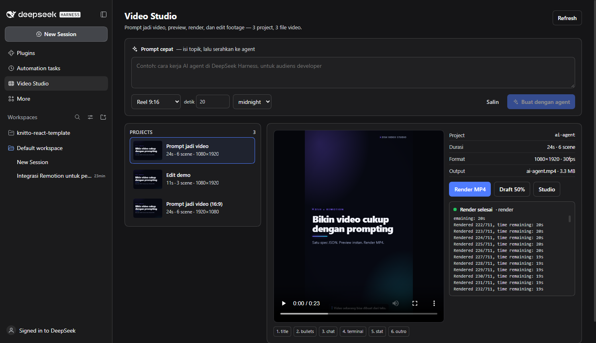
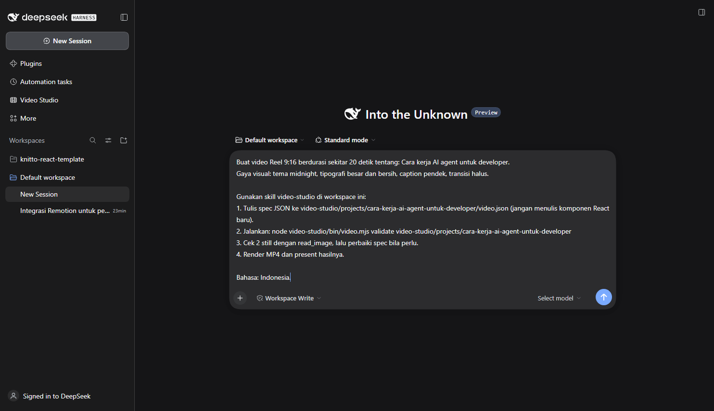

# dsh-video-studio (DSH plugin)

Panel **Video Studio** di sidebar GUI DSH: daftar project video, preview MP4
langsung di halaman, tombol render (penuh/draft), peluncur Remotion Studio, dan
kotak prompt yang membuka sesi agent baru dengan instruksi siap kirim.

Plugin ini adalah kulit GUI untuk [`video-studio/`](../../video-studio/README.md);
semua pekerjaan render tetap dilakukan CLI `video-studio/bin/video.mjs`.



## Yang ditambahkan

| Bagian | Fungsi |
|---|---|
| `sidebar.panellist` | Entri **Video Studio** dengan ikon film |
| `main` | Halaman panel: prompt cepat, daftar project, preview, aksi render |
| Host routes | `/video-studio/api/*` + `/video-studio/media/*` |

Panel membaca spec JSON tiap project (`meta`, jumlah scene, durasi, tema),
menampilkan video terbaru, dan memutar MP4 lewat route media yang mendukung
HTTP Range (seeking berfungsi).

Tombol:

- **Render MP4** — render penuh, menimpa `<project>/out/<slug>.mp4`.
- **Draft 50%** — render setengah resolusi ke `<slug>-draft.mp4` untuk review cepat.
- **Studio** — menjalankan `remotion studio` di port `studioPort` (default 3211)
  lalu membuka tab baru; berguna untuk scrub timeline.
- **Buat dengan agent** — membuat sesi baru dengan prompt yang sudah terisi
  (format, durasi, tema, path spec, dan langkah validasi/render). Pengguna
  tinggal menekan kirim.
- **Salin** — menyalin prompt ke clipboard.



## Konfigurasi

Di `cordis.patch.yml` bundle:

```yaml
- insert:
    - id: video-studio
      name: dsh-video-studio
      config:
        # studioDir auto-detect; isi hanya kalau engine ada di folder lain.
        # studioDir: 'D:\video\dsh-video-studio\video-studio'
        studioPort: 3211
        # nodePath: 'C:\Program Files\nodejs\node.exe'   # opsional
```

| Field | Default | Arti |
|---|---|---|
| `studioDir` | auto-detect | Folder berisi `bin/video.mjs` dan `projects/`. Dicari dari env `DSH_VIDEO_STUDIO_DIR`, lalu `<repo>/video-studio`, lalu `<plugin>/engine`, lalu `./video-studio` |
| `studioPort` | `3211` | Port Remotion Studio |
| `nodePath` | auto-detect | Binary Node. Urutan: config ini → `DSH_VIDEO_STUDIO_NODE` → `node` di PATH → Node bawaan DSH → Electron-as-Node |

## Instalasi

```powershell
git clone <repo-url> dsh-video-studio
cd dsh-video-studio
.\setup.ps1
```

Atau manual:

```powershell
cd video-studio
npm ci
dsh plugin --profile desktop add "link:<repo>\plugins\dsh-video-studio"
```

Profile dengan HMR akan memuat plugin tanpa restart; tanpa HMR, restart aplikasi.
Cek cepat:

```powershell
curl http://127.0.0.1:<port-gui>/video-studio/api/state
```

## HTTP API (internal panel)

| Method | Path | Fungsi |
|---|---|---|
| GET | `/video-studio/api/state` | Project, output, job, status studio |
| GET | `/video-studio/api/jobs` | Daftar job render |
| GET | `/video-studio/api/spec/<slug>` | Spec JSON mentah |
| POST | `/video-studio/api/render` | `{slug, draft?}` → mulai render |
| POST | `/video-studio/api/studio` | `{slug}` → jalankan/buka Remotion Studio |
| GET/HEAD | `/video-studio/media/<slug>/<path>` | File di `<project>/out/` dengan Range |

POST wajib menyertakan header `x-video-studio: 1`; semua route hanya menerima
koneksi loopback. Path media di-resolve dan ditolak bila keluar dari folder `out/`.

## Pengembangan

- Client bundle ditulis sebagai factory `window.__ModuleLoader__.load` di
  `lib/client.js` — tidak perlu build; HMR memuat ulang setelah file berubah.
- Host half (`lib/index.js`) memakai `ctx.webServer.register({kind:'prefix'})`
  dan `spawn` Node untuk render/studio.
- Setelah mengubah kode host, profile dengan HMR me-reload plugin; jika tidak,
  restart aplikasi.
- Job render disimpan di memori (maks 20); riwayat permanen ada di
  `projects/<slug>/renders.json` yang ditulis CLI.

## Batasan

- Satu render per project dalam satu waktu; belum ada tombol cancel.
- Render berjalan lokal dan memakai CPU/GPU mesin ini (rasio ~2–3× durasi video).
- Panel belum bisa mengedit scene; editing tetap lewat agent/CLI (`scene add`,
  `set`, `audio`, dst.).
- Remotion Studio memakai satu proses per plugin; ganti project berarti restart
  proses studio di port yang sama.
